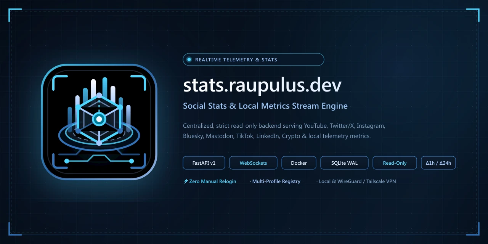

<p align="center">
  
</p>

# Social Stats API & WebSockets

Herramienta centralizada, empaquetada en un contenedor **Docker** y desarrollada en **Python**, diseñada para monitorizar estadísticas en tiempo real de **14 proveedores**: redes sociales, canales, streaming, forjas Git (`YouTube`, `Twitch`, `GitHub`, `GitLab`, `Telegram`, `Bluesky`, `Mastodon`, `Twitter/X`, `Instagram`, `TikTok`, `Facebook`, `LinkedIn`), cotización global de criptomonedas (`BTC`, `ADA` en USD y EUR) y telemetría de entrada (`Keycounter` teclado y ratón).

Incluye un **panel web público de telemetría (`public/`)** listo para publicarse en internet como `DocumentRoot` aislado (ej. `https://stats.raupulus.dev/`) conectado por WebSocket público de solo lectura (`/ws/public`), manteniendo la API REST (`/api/v1/*`) y los WebSockets completos (`/ws/stats`) estrictamente privados con autenticación Bearer para dispositivos IoT, pantallas de escritorio o scripts locales/VPN.

---

## Características Principales

- **Arquitectura Estrictamente Read-Only (Unidireccional):**
  - Los clientes únicamente consumen información a través de **API REST** (`GET /api/v1/*` privado) y **WebSockets** (`/ws/public` y `/ws/stats` privado).
  - Cualquier método HTTP distinto de `GET`, `HEAD` u `OPTIONS` recibe `405 Method Not Allowed`. Los clientes nunca envían comandos ni mutaciones al servidor.
- **Dashboard Web Público Seguro (`public/`):**
  - Interfaz con estética **«Deep-Space Blue Cyber-Telemetry»** basada en la paleta de `https://raupulus.dev/`, `100%` libre de `innerHTML` (`document.createElement` + `textContent`) y protegida con `Content-Security-Policy`, `HSTS`, `COOP`, `CORP` y `X-Frame-Options: DENY`.
  - Todos los perfiles públicos aparecen seleccionados (`✓ ACTIVO`) por defecto al entrar, con iconos `.webp` optimizados en la cabecera de cada plataforma, botón de copiado rápido de enlace al portapapeles, apertura de cada red social en pestaña nueva (`target="_blank"`), cotización Cripto Spot global e independiente del perfil y ocultación automática de la sección `Keycounter` cuando se filtra un perfil que no tiene contador asociado.
- **14 Colectores Asíncronos Desacoplados (`BaseCollector`):**
  - **Redes y Canales:** `YouTube` (batch hasta 50 canales), `Twitter/X` (Syndication + SSR fallback), `Instagram` (Graph API + Web/OpenGraph), `TikTok` (hidratación SSR + Display API v2), `Facebook` (Graph API + OpenGraph), `Telegram` (vista previa pública sin Bot Token en URL), `Bluesky` (AT Protocol), `Mastodon` (REST multi-instancia) y `LinkedIn`.
  - **Streaming y Directos:** `Twitch` (Helix OAuth2 + GQL público con detección de estado `EN DIRECTO` y espectadores concurrentes).
  - **Forjas Git:** `GitHub` y `GitLab` (multi-instancia) con agregación de seguidores, repositorios/proyectos públicos, estrellas totales (`★`) y forks totales.
  - **Cripto Spot Global y Keycounter por Perfil:** `Binance Public API` (`BTC`, `ADA` en USD y EUR a nivel global) y `Keycounter API v2` (pulsaciones de teclas y clics de ratón).
- **Métricas Temporales en Tiempo Real ($\Delta_{1h}$ y $\Delta_{24h}$):**
  - Cálculo exacto en el servidor de variaciones de última hora y último día mediante series temporales de snapshots en SQLite (`WAL`), sin depender de APIs analíticas con retrasos de 48 horas.
- **Operación Desatendida (Zero Manual Relogin) y Tolerancia a Fallos:**
  - Cero credenciales en URLs (todas las claves viajan en cabeceras HTTP y los errores se sanitizan antes de guardarse en memoria o disco). Ante caídas o límites de cuota externos, el sistema responde con el último dato válido en caché (`stale data`) sin interrumpir el servicio.

---

## Arquitectura General

```text
┌──────────────────────────────────────────────────────────────────────────────┐
│                           DOCKER CONTAINER (Python 3.12)                     │
│                                                                              │
│  ┌──────────────────────────┐              ┌──────────────────────────────┐  │
│  │  14 Async Collectors     │              │    StateStore (In-Memory)    │  │
│  │  - Social / Git / Stream │ ───────────► │   + SQLite WAL (Snapshots)   │  │
│  │  - Global Crypto / Keycnt│              └──────────────┬───────────────┘  │
│  └──────────────────────────┘                             │                  │
│                                                           ▼                  │
│                                            ┌──────────────────────────────┐  │
│                                            │   FastAPI Read-Only Server   │  │
│                                            │  - Public Static (public/)   │  │
│                                            │  - 3 Security Channels       │  │
│                                            └──┬─────────────┬───────────┬─┘  │
└───────────────────────────────────────────────┼─────────────┼───────────┼────┘
                                                │             │           │
                     ┌──────────────────────────┘             │           └──────────────────────┐
                     ▼                                        ▼                                  ▼
      ┌──────────────────────────────┐         ┌─────────────────────────────┐    ┌─────────────────────────────┐
      │   Canal 1: Público Internet  │         │  Canal 2: WS Privado (VPN)  │    │ Canal 3: REST Privada (IoT) │
      │  - Web Estática (public/)    │         │  - WS /ws/stats (Bearer)    │    │  - GET /api/v1/* (Bearer)   │
      │  - WS /ws/public (Read-Only) │         │  - Métricas 100% completas  │    │  - Local Docker /healthz    │
      └──────────────────────────────┘         └─────────────────────────────┘    └─────────────────────────────┘
```

---

## Despliegue en Producción (Docker, Permisos y Proxy Inverso)

### 1. Preparación de Archivos y Permisos del Volumen (`UID 10001`)

El contenedor se ejecuta con sistema de archivos raíz de solo lectura (`read_only: true`), sin capacidades de kernel (`cap_drop: [ALL]`) y bajo el usuario sin privilegios `appuser` (`UID 10001` / `GID 10001`).

1. Copiar las plantillas de configuración y crear el directorio de persistencia SQLite (`WAL`):
   ```bash
   cp .env.example .env
   cp config/profiles.example.json config/profiles.json
   mkdir -p data
   ```
2. Asignar permisos de escritura al directorio `data/` para el usuario `10001:10001` del contenedor:
   ```bash
   sudo chown -R 10001:10001 data
   chmod 750 data
   ```
3. Generar un token criptográfico para `API_BEARER_TOKEN` e introducirlo en `.env` junto con los orígenes permitidos y las claves de API necesarias:
   ```bash
   python3 -c "import secrets; print(secrets.token_urlsafe(48))"
   ```
   Variables clave en `.env`:
   - `BIND_IP=127.0.0.1` (para exponer el puerto solo al proxy inverso local o IP de la interfaz VPN).
   - `API_BEARER_TOKEN=<tu_token_generado>` (protege `/api/v1/*`, `/ws/stats` y `/ws/profiles/*`).
   - `WS_PUBLIC_ALLOWED_ORIGINS=https://stats.raupulus.dev` (lista separada por comas de dominios autorizados para `/ws/public`).
   - `CORS_ALLOWED_ORIGINS=https://stats.raupulus.dev`

### 2. Construcción, Arranque y Verificación con Docker Compose

```bash
# Construir imagen multi-stage e iniciar en segundo plano
docker compose up --build -d

# Comprobar estado (debe aparecer 'healthy' gracias a GET /healthz local)
docker compose ps

# Consultar logs en tiempo real
docker compose logs -f social-stats

# Verificar healthcheck interno y API privada con Bearer Token
curl http://127.0.0.1:8000/healthz
curl -H "Authorization: Bearer <API_BEARER_TOKEN>" http://127.0.0.1:8000/api/v1/health
```

### 3. Montajes y Endurecimiento en `docker-compose.yml`

| Recurso | Ruta en Host | Ruta en Contenedor | Modo | Propósito |
|---|---|---|---|---|
| Configuración de perfiles | `./config` | `/app/config` | `:ro` (Solo lectura) | Carga declarativa de `profiles.json` o `profiles.yaml`. |
| Dashboard web público | `./public` | `/app/public` | `:ro` (Solo lectura) | Activos estáticos (`index.html`, CSS, JS, iconos `.webp`, SEO). |
| Base de datos histórica | `./data` | `/app/data` | Lectura/Escritura (`10001:10001`) | Base de datos SQLite en modo `WAL` (`stats.db`, `-wal`, `-shm`). |
| Caché efímera runtime | `tmpfs` (RAM) | `/tmp` (`64M`) | Escritura en memoria | Caché temporal de `curl_cffi` con el raíz en `read_only: true`. |

### 4. Configuración de Proxy Inverso (Nginx / Caddy) para `stats.raupulus.dev`

Para publicar en internet **únicamente el Canal 1** (archivos estáticos de `public/` + WebSocket público `/ws/public`) manteniendo los endpoints `/api/v1/*`, `/ws/stats` y `/healthz` inaccesibles desde el exterior (restringidos a red local / VPN vía `127.0.0.1:8000`):

#### Opción A — Nginx (`DocumentRoot` estático + Proxy exclusivo a `/ws/public`)

```nginx
server {
    listen 443 ssl http2;
    server_name stats.raupulus.dev;

    # Servir directamente el dashboard estático público
    root /ruta/al/repositorio/public;
    index index.html;

    # Proxy inverso exclusivamente para el WebSocket público de solo lectura
    location = /ws/public {
        proxy_pass http://127.0.0.1:8000/ws/public;
        proxy_http_version 1.1;
        proxy_set_header Upgrade $http_upgrade;
        proxy_set_header Connection "upgrade";
        proxy_set_header Host $host;
        proxy_set_header Origin $http_origin;
        proxy_set_header X-Real-IP $remote_addr;
        proxy_set_header X-Forwarded-For $proxy_add_x_forwarded_for;
        proxy_set_header X-Forwarded-Proto $scheme;
        proxy_read_timeout 86400s;
    }

    # Bloquear explícitamente cualquier acceso público a rutas privadas
    location ~ ^/(api|ws/stats|ws/profiles|healthz|docs|redoc|openapi\.json) {
        return 403;
    }

    location / {
        try_files $uri $uri/ /index.html;
    }
}
```

#### Opción B — Caddy (`Caddyfile`)

```caddyfile
stats.raupulus.dev {
    @private path /api/* /ws/stats* /ws/profiles* /healthz* /docs* /redoc* /openapi.json
    respond @private 403

    handle /ws/public* {
        reverse_proxy 127.0.0.1:8000
    }

    handle {
        root * /ruta/al/repositorio/public
        file_server
    }
}
```

### 5. Ejecución en Entorno Local (Desarrollo sin Docker con Python 3.12+)

```bash
python3 -m venv .venv
.venv/bin/pip install -e ".[dev]"
cp .env.example .env
cp config/profiles.example.json config/profiles.json
mkdir -p data
.venv/bin/social-stats
```

---

## Arquitectura de Seguridad de 3 Canales (Read-Only)

1. **Canal 1 — Web Pública y WebSocket Público (`public/` + `WS /ws/public`):**
   - El directorio `public/` actúa como `DocumentRoot` aislado para `https://stats.raupulus.dev/` (o servido automáticamente en `/` con `follow_symlink=False`).
   - `WS /ws/public` no requiere token, pero aplica validación estricta de `Origin` (`WS_PUBLIC_ALLOWED_ORIGINS`), límite de conexiones por IP (`WS_PUBLIC_MAX_PER_IP`), límite global (`WS_PUBLIC_MAX_CONNECTIONS`), tamaño máximo de trama (`--ws-max-size 1024`) y cierre inmediato (`1008`) al primer mensaje entrante del cliente.
   - Expone únicamente perfiles/cuentas con `"public": true`, cripto spot global (`BTC`, `ADA` en USD y EUR) y en `keycounter` **exclusivamente los totales acumulados históricos** (`pulsations_total` y `clicks_total`, redactando a `null` las ventanas de 1h y hoy). Nunca expone `error_message`, `last_attempt_at` ni eventos `collector_status`.
2. **Canal 2 — WebSocket Privado Autenticado (`WS /ws/stats` y `WS /ws/profiles/{profile_id}`):**
   - Requiere `API_BEARER_TOKEN` (`Authorization: Bearer <token>`, `Sec-WebSocket-Protocol: bearer, <token>` o `?token=<token>`).
   - Emite el 100% de las métricas sin recortes (incluyendo ventanas 1h y hoy de Keycounter, perfiles privados y eventos `collector_status`).
3. **Canal 3 — API REST Privada Autenticada (`GET /api/v1/*` con `Authorization: Bearer <API_BEARER_TOKEN>`):**
   - `GET /api/v1/health` — Salud del contenedor, base de datos SQLite y estado detallado de los 14 colectores.
   - `GET /api/v1/profiles` — Catálogo de perfiles configurados.
   - `GET /api/v1/crypto` — Cotizaciones spot globales y estadísticas 24h de criptomonedas (`BTC`, `ADA`) en USD y EUR (`?symbol=`).
   - `GET /api/v1/keycounter` — Estadísticas completas de pulsaciones de teclas y clics de ratón (totales, hoy y última hora, `?account=`).
   - `GET /api/v1/stats` — Estadísticas globales (filtrables con `?profile=` y `?platform=`).
   - `GET /api/v1/profiles/{profile_id}/stats` — Estadísticas agregadas y por cuenta de un perfil.
   - `GET /api/v1/profiles/{profile_id}/history?window=24h` — Serie temporal histórica (`1h`, `24h`, `7d`, `30d`).
   - *(Healthcheck interno de Docker: `GET /healthz`, restringido exclusivamente a loopback local `127.0.0.1` / `::1` sin cabeceras de proxy inverso).*

---

## Documentación Técnica

La documentación del proyecto sigue un estricto protocolo de actualización continua sincronizado con el código:

- **[Índice Maestro de Documentación Viva (`docs/info/`)](docs/info/README.md):** Estado técnico verificado de módulos, componentes y contratos.
- **[Guía de Despliegue y Credenciales Permanentes (`docs/deploys/docker-y-credenciales.md`)](docs/deploys/docker-y-credenciales.md):** Configuración paso a paso de Docker, VPN y API Keys sin caducidad.
- **[Decisiones Técnicas (`docs/info/decisiones-tecnicas.md`)](docs/info/decisiones-tecnicas.md):** Registro inmutable de decisiones arquitectónicas del sistema.
- **[Guía de Diseño Visual (`docs/info/DESIGN.md`)](docs/info/DESIGN.md):** Pautas de diseño para visualización en pantallas de escritorio.
- **[Catálogo de Componentes (`docs/info/COMPONENTS.md`)](docs/info/COMPONENTS.md):** Especificación de componentes de presentación para dashboards.
- **[Inventario de Comandos (`docs/info/commands.md`)](docs/info/commands.md):** Registro de scripts y comandos de ejecución.

---

## Licencia

Este proyecto está distribuido bajo los términos de la licencia **GNU Affero General Public License v3** ([AGPL-3.0](LICENSE)).

---

## Autor y Créditos

- **Autor:** [@raupulus](https://raupulus.dev)
- **Sitio Web:** [raupulus.dev](https://raupulus.dev)
- **Contacto público:** [public@raupulus.dev](mailto:public@raupulus.dev)
